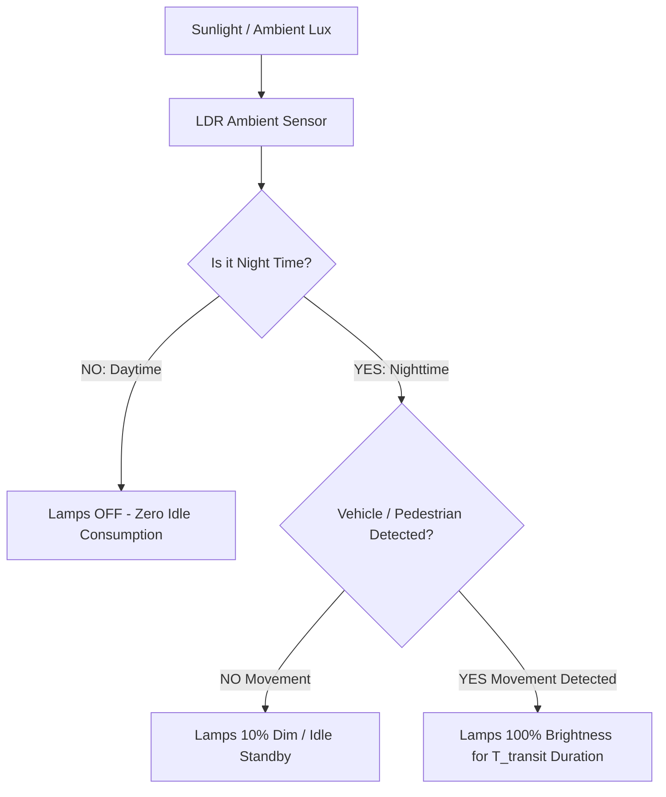

# Adaptive Smart Street Light Controller: Dual PIR + LDR Ambient Lux & Vehicle Motion Sensing (Deployed on University Campus)

> **Smart City & Green Energy Infrastructure | Graphic Era Hill University (B.Tech ECE 2023–2027)**  
> **Author:** Parth Dalakoti (*President, Robotics & Automation Club, GEHU*)  
> **Contact:** `parthdalakoti482@gmail.com` | [LinkedIn](https://linkedin.com/in/parthdalakoti)

---

## ⚡ Executive Summary

Designed and **successfully deployed on the Graphic Era Hill University (GEHU) campus**, this green-energy infrastructure project cuts municipal lighting energy consumption by up to **70%**:
1. **Day/Night Ambient Discrimination:** A cadmium sulfide (CdS) **LDR sensor** connected via an analog voltage divider disables all street lamps during daylight hours, eliminating human error in timer switches.
2. **Predictive Dual-PIR Motion Sensing:** Staggered **pyroelectric infrared (PIR) sensors** detect approaching vehicles, bicycles, and pedestrians, automatically brightening forward lighting clusters dynamically.
3. **Zero Waste Sleep Transition:** Luminaires idle at ultra-low power (or turn completely off) when roadways are vacant, automatically returning to high-intensity illumination upon motion detection.

---

## ⚙️ Logic State Machine & Energy Saving Flow

---

## 🛠️ Bill of Materials (BOM)

| Component | Part / Spec | Voltage | Interface | Purpose |
| :--- | :--- | :--- | :--- | :--- |
| **Microcontroller** | ESP32-WROOM-32 (240MHz) | 3.3V Logic / 5V USB | ADC, GPIO Interrupts | Lighting scheduler & sensor processing |
| **Motion Sensor (x2)** | HC-SR501 Pyroelectric PIR | 5V | Digital Output (Pins 18, 19) | Dual-zone vehicle & pedestrian tracking |
| **Ambient Light Sensor**| GL5528 CdS Photoresistor (LDR) | 5V (10k divider) | Analog ADC Pin 34 | Day vs night optical discrimination |
| **Power Switch** | 5V Optocoupled Relay / High-Power MOSFET | 5V / 12V-230V | GPIO Pin 26 | High-output street luminaire driver |

---

## 🔌 Hardware Pin Connections

| ESP32 Pin | Peripheral Line | Function |
| :--- | :--- | :--- |
| **GPIO 34** | LDR Analog Voltage Divider | Ambient light lux level |
| **GPIO 18** | PIR Sensor 1 (Approach Zone) | Forward motion detection |
| **GPIO 19** | PIR Sensor 2 (Departure Zone) | Exit motion confirmation |
| **GPIO 26** | Luminaire Relay / Power MOSFET | High-power lamp driver |

---

## 👨‍💻 Engineering Author
**Parth Dalakoti**  
*B.Tech in Electronics & Communication Engineering (2023–2027)*  
*Graphic Era Hill University (GEHU), Bhimtal Campus*  
*President, Robotics & Automation Club, GEHU*
